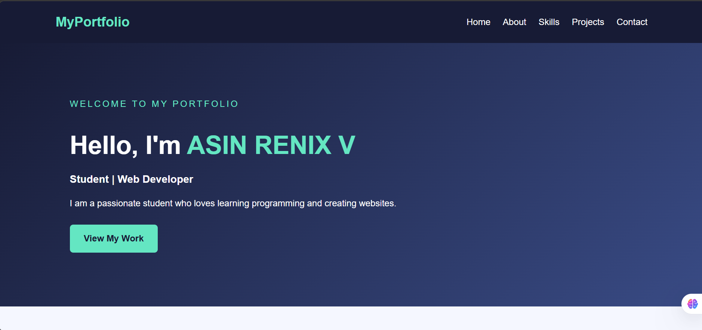
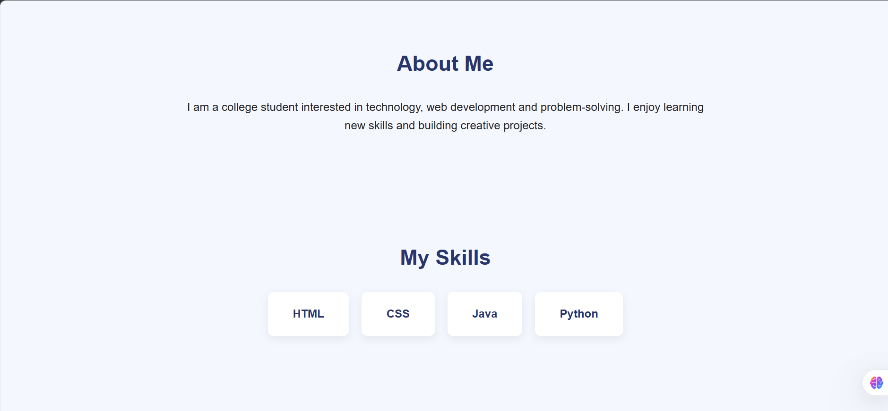
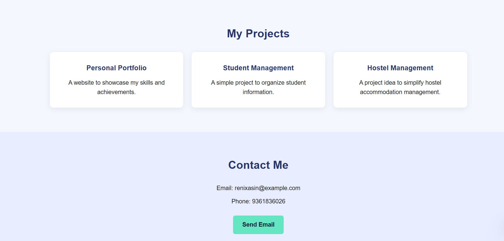

# Ex01 Portfolio
## Date: 27-10-2026
## Reg No: 212224040036
## Name: Asin Renix V

## AIM
To create a Portfolio using HTML and CSS.

## ALGORITHM
### STEP 1
Create an HTML file (index.html)

### STEP 2
Create a CSS file (style.css)

### STEP 3
Include a navigation bar with links to different sections.

### STEP 4
Add structured sections for introduction, about, projects, and contact details.

### STEP 5
Define global styles for fonts, colors, and layout.

### STEP 6
Style the header, navigation bar, and sections.

### STEP 7
Use Flexbox or CSS Grid for layout design.

### STEP 8
Add hover effects and transitions for interactivity.

### STEP 9
Add Images and Media.

### STEP 10
Use optimized images for a professional look.

### STEP 11
Open the HTML file in a browser to check layout and functionality.

### STEP 12
Fix styling issues and refine content placement.

### STEP 13
Deploy the Portfolio.

### STEP 14
Upload to GitHub Pages for free hosting.

## PROGRAM

HTML
```
<!DOCTYPE html>
<html lang="en">
<head>
    <meta charset="UTF-8">
    <meta name="viewport" content="width=device-width, initial-scale=1.0">
    <title>My Portfolio</title>
    <link rel="stylesheet" href="style.css">
</head>
<body>

    <!-- Navigation -->
    <header>
        <nav>
            <h2 class="logo">MyPortfolio</h2>
            <ul>
                <li><a href="#home">Home</a></li>
                <li><a href="#about">About</a></li>
                <li><a href="#skills">Skills</a></li>
                <li><a href="#projects">Projects</a></li>
                <li><a href="#contact">Contact</a></li>
            </ul>
        </nav>
    </header>

    <!-- Home Section -->
    <section id="home" class="hero">
        <div class="hero-content">
            <p class="welcome">WELCOME TO MY PORTFOLIO</p>
            <h1>Hello, I'm <span>ASIN RENIX V</span></h1>
            <h3>Student | Web Developer</h3>
            <p>
                I am a passionate student who loves learning
                programming and creating websites.
            </p>
            <a href="#projects" class="btn">View My Work</a>
        </div>
    </section>

    <!-- About Section -->
    <section id="about" class="section">
        <h2>About Me</h2>
        <p>
            I am a college student interested in technology,
            web development and problem-solving. I enjoy
            learning new skills and building creative projects.
        </p>
    </section>

    <!-- Skills Section -->
    <section id="skills" class="section">
        <h2>My Skills</h2>
        <div class="skills-container">
            <div class="skill">HTML</div>
            <div class="skill">CSS</div>
            <div class="skill">Java</div>
            <div class="skill">Python</div>
        </div>
    </section>

    <!-- Projects Section -->
    <section id="projects" class="section">
        <h2>My Projects</h2>
        <div class="projects-container">
            <div class="project-card">
                <h3>Personal Portfolio</h3>
                <p>A website to showcase my skills and achievements.</p>
            </div>

            <div class="project-card">
                <h3>Student Management</h3>
                <p>A simple project to organize student information.</p>
            </div>

            <div class="project-card">
                <h3>Hostel Management</h3>
                <p>A project idea to simplify hostel accommodation management.</p>
            </div>
        </div>
    </section>

    <!-- Contact Section -->
    <section id="contact" class="section contact">
        <h2>Contact Me</h2>
        <p>Email: renixasin@example.com</p>
        <p>Phone: 9361836026</p>
        <a href="mailto:renixasin@example.com" class="btn">
            Send Email
        </a>
    </section>

    <!-- Footer -->
    <footer>
        <p>&copy; 2026 ASIN RENIX V | My Portfolio</p>
    </footer>

</body>
</html>
```
CSS

```
/* General Styles */
* {
    margin: 0;
    padding: 0;
    box-sizing: border-box;
    scroll-behavior: smooth;
}

body {
    font-family: Arial, sans-serif;
    line-height: 1.6;
    background: #f5f7ff;
    color: #222;
}

/* Navigation */
header {
    background: #171b35;
    padding: 18px 8%;
}

nav {
    display: flex;
    justify-content: space-between;
    align-items: center;
    flex-wrap: wrap;
    gap: 15px;
}

.logo {
    color: #64e6c2;
}

nav ul {
    display: flex;
    list-style: none;
    gap: 22px;
    flex-wrap: wrap;
}

nav a {
    text-decoration: none;
    color: white;
    transition: color 0.3s;
}

nav a:hover {
    color: #64e6c2;
}

/* Home Section */
.hero {
    min-height: 80vh;
    display: flex;
    align-items: center;
    padding: 60px 10%;
    background: linear-gradient(135deg, #171b35, #394b85);
    color: white;
}

.hero-content {
    max-width: 650px;
}

.welcome {
    color: #64e6c2;
    letter-spacing: 3px;
    margin-bottom: 15px;
}

.hero h1 {
    font-size: 45px;
    margin-bottom: 10px;
}

.hero h1 span {
    color: #64e6c2;
}

.hero h3 {
    margin-bottom: 15px;
}

.hero p {
    margin-bottom: 25px;
}

/* Buttons */
.btn {
    display: inline-block;
    background: #64e6c2;
    color: #171b35;
    padding: 12px 25px;
    border-radius: 6px;
    text-decoration: none;
    font-weight: bold;
    transition: 0.3s;
}

.btn:hover {
    background: white;
    transform: translateY(-3px);
}

/* Common Sections */
.section {
    padding: 65px 10%;
    text-align: center;
}

.section h2 {
    font-size: 30px;
    color: #28366c;
    margin-bottom: 25px;
}

.section > p {
    max-width: 750px;
    margin: 0 auto 20px;
}

/* Skills */
.skills-container {
    display: flex;
    justify-content: center;
    flex-wrap: wrap;
    gap: 18px;
}

.skill {
    background: white;
    color: #28366c;
    padding: 18px 35px;
    border-radius: 8px;
    box-shadow: 0 4px 12px #00000012;
    font-weight: bold;
    transition: 0.3s;
}

.skill:hover {
    background: #64e6c2;
    transform: translateY(-5px);
}

/* Projects */
.projects-container {
    display: grid;
    grid-template-columns: repeat(3, 1fr);
    gap: 22px;
}

.project-card {
    background: white;
    padding: 28px 20px;
    border-radius: 10px;
    box-shadow: 0 4px 15px #00000012;
    transition: 0.3s;
}

.project-card:hover {
    transform: translateY(-6px);
}

.project-card h3 {
    color: #28366c;
    margin-bottom: 12px;
}

/* Contact */
.contact {
    background: #e8edff;
}

.contact p {
    margin-bottom: 10px;
}

.contact .btn {
    margin-top: 15px;
}

/* Footer */
footer {
    text-align: center;
    padding: 20px;
    background: #171b35;
    color: white;
}

/* Responsive Design */
@media (max-width: 768px) {
    nav {
        justify-content: center;
    }

    nav ul {
        justify-content: center;
        gap: 12px;
    }

    .hero h1 {
        font-size: 34px;
    }

    .projects-container {
        grid-template-columns: 1fr;
    }

    .section {
        padding: 45px 6%;
    }
}
```
## OUTPUT





## RESULT
The program for creating Portfolio using HTML and CSS is executed successfully.
